<!-- ======================================================================= -->
<!-- 01. NEURAL CYBER COMMAND DECK (SELF-HOSTED ANIMATED SVG)                -->
<!-- ======================================================================= -->
<p align="center">
  <a href="https://github.com/tumbaltok">
    
  </a>
</p>

<!-- ======================================================================= -->
<!-- 02. LIVE CLEARANCE & TELEMETRY BADGES                                   -->
<!-- ======================================================================= -->
<p align="center">
  
  
  
  
</p>

<br/>

<!-- ======================================================================= -->
<!-- 03. BENTO GRID ROW 1: SYSTEM IDENTITY + OMNI-SKILL RADAR                -->
<!-- ======================================================================= -->
<p align="center">
  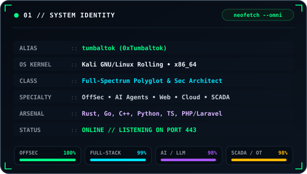
  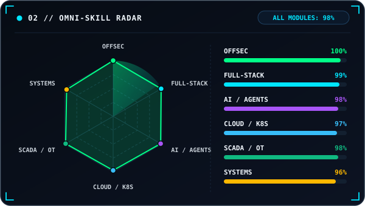
</p>

<!-- ======================================================================= -->
<!-- 04. POLYGLOT ARSENAL MATRIX & FULL-SPECTRUM TECH STACK                  -->
<!-- ======================================================================= -->
<p align="center">
  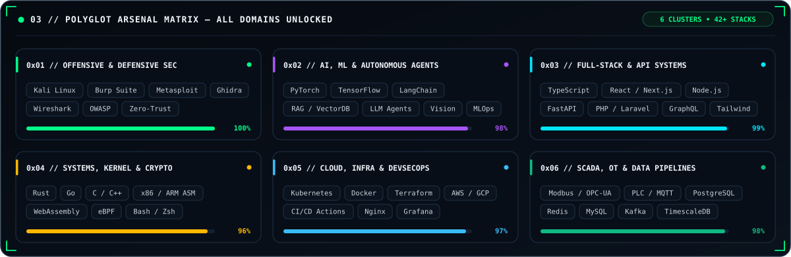
</p>

<p align="center">
  
</p>

<br/>

<!-- ======================================================================= -->
<!-- 05. BENTO GRID ROW 2: LIVE GITHUB TELEMETRY + RUNTIME LANGUAGES         -->
<!-- ======================================================================= -->
<p align="center">
  <a href="https://github.com/tumbaltok?tab=repositories">
    
  </a>
  <a href="https://github.com/tumbaltok?tab=repositories">
    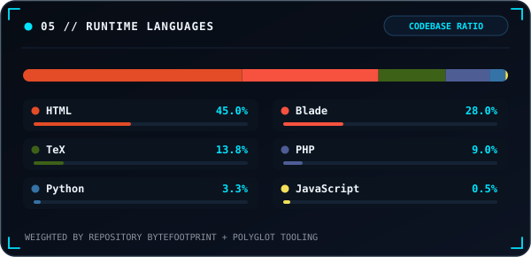
  </a>
</p>

<!-- ======================================================================= -->
<!-- 06. NEURAL CONTRIBUTION MATRIX & VELOCITY SPLINE                        -->
<!-- ======================================================================= -->
<p align="center">
  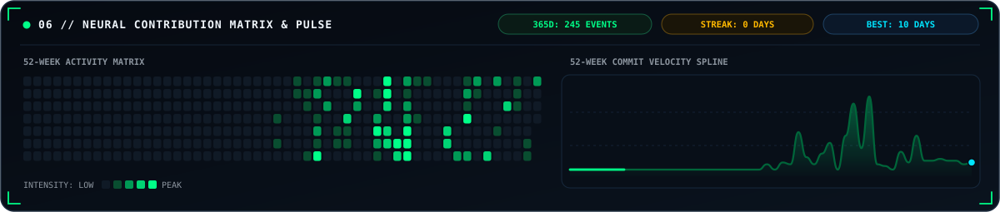
</p>

<br/>

<!-- ======================================================================= -->
<!-- 07. BENTO GRID ROW 3: FEATURED PAYLOADS (CLICKABLE REPO CARDS)          -->
<!-- ======================================================================= -->
### ```[ root@tumbaltok:~# ls -la /opt/active_payloads/ ]```

<p align="center">
  <a href="https://github.com/tumbaltok/NDOK-Scada">
    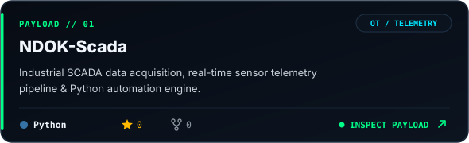
  </a>
  <a href="https://github.com/tumbaltok/Umbulan">
    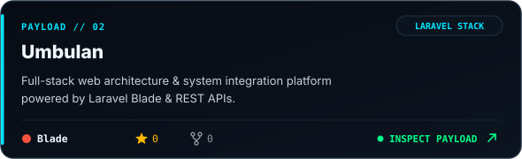
  </a>
</p>

<p align="center">
  <a href="https://github.com/tumbaltok/ShordLink">
    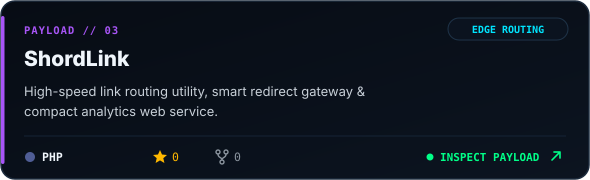
  </a>
  <a href="https://github.com/tumbaltok/TehTawa">
    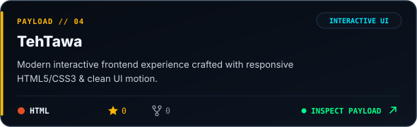
  </a>
</p>

<br/>

<!-- ======================================================================= -->
<!-- 08. INTERACTIVE ENCRYPTED DOSSIERS (CLICK TO DECRYPT)                   -->
<!-- ======================================================================= -->
### ```[ root@tumbaltok:~# ./decrypt_vault.sh --interactive ]```

<details>
  <summary><b><code>[+] ./decrypt_manifesto.sh</code> — Klik untuk membuka profil &amp; filosofi arsitektur</b></summary>
  <br/>

```text
================================================================================
[!] DECRYPTING FILE: MANIFESTO.ENC ... 100% VERIFIED
================================================================================
> "Master every layer of the stack — from raw kernel packets to autonomous AI."

Saya adalah pengembang sistem polyglot, arsitek perangkat lunak, dan antusias
keamanan siber yang beroperasi lintas domain: offensive/defensive security,
full-stack web modern, otomasi AI & LLM agents, infrastruktur cloud-native,
serta sistem industri real-time (SCADA / OT).

* [✓] Offensive Security, Red Teaming, Reverse Engineering & Zero-Trust Hardening
* [✓] Full-Stack Architecture (TypeScript, Next.js, Python FastAPI, PHP Laravel)
* [✓] Systems & Low-Level Engineering (Rust, Go, C/C++, eBPF, WebAssembly)
* [✓] AI Engineering, RAG Pipelines, Computer Vision & Autonomous Agents
* [✓] Cloud Infrastructure, Kubernetes, CI/CD & Industrial SCADA Telemetry
================================================================================
```
</details>

<details>
  <summary><b><code>[+] ./scan_capabilities.sh</code> — Klik untuk membuka matriks kapabilitas lintas domain</b></summary>
  <br/>

| Kode | Domain Operasi | Cakupan Teknologi &amp; Implementasi |
| :--- | :--- | :--- |
| **`OP-01`** | **Offensive &amp; Defensive Security** | Penetration testing (OWASP Top 10), OSINT, binary analysis (Ghidra), packet inspection, exploit dev &amp; server hardening. |
| **`OP-02`** | **AI, ML &amp; Autonomous Agents** | PyTorch, TensorFlow, LangChain, multi-agent orchestration, RAG &amp; VectorDB, MLOps &amp; edge inference. |
| **`OP-03`** | **Full-Stack &amp; API Architecture** | TypeScript, React, Next.js, Node.js, Python (FastAPI), PHP (Laravel), GraphQL, REST &amp; WebSockets real-time. |
| **`OP-04`** | **Systems, Kernel &amp; Cryptography** | Rust, Go, C/C++, Assembly (x86/ARM), eBPF observability, WebAssembly &amp; high-concurrency services. |
| **`OP-05`** | **Cloud, Containers &amp; DevSecOps** | Kubernetes, Docker, Terraform, AWS/GCP, GitHub Actions CI/CD, Prometheus &amp; Grafana telemetry. |
| **`OP-06`** | **SCADA, IoT &amp; Data Pipelines** | Modbus/OPC-UA, MQTT, PLC telemetry, TimescaleDB, PostgreSQL, Redis, Kafka &amp; Python data loggers. |

</details>

<details>
  <summary><b><code>[+] ./verify_comms.sh</code> — Klik untuk membuka jalur komunikasi terenkripsi</b></summary>
  <br/>

```bash
root@tumbaltok:~# ping -c 1 github.com/tumbaltok
PING github.com/tumbaltok (140.82.121.4): 56 data bytes
64 bytes from tumbaltok: icmp_seq=0 ttl=54 time=9.8 ms [HANDSHAKE VERIFIED]

> GitHub Node     : https://github.com/tumbaltok
> PGP Fingerprint : 4F92 88A1 C04E 77B2 [VERIFIED]
> Transmission    : Open for security research, AI systems & full-stack collabs.
```

> Direct Link: [github.com/tumbaltok](https://github.com/tumbaltok)

</details>

<br/>

<!-- ======================================================================= -->
<!-- 09. ANIMATED CYBER WAVE FOOTER                                          -->
<!-- ======================================================================= -->
<p align="center">
  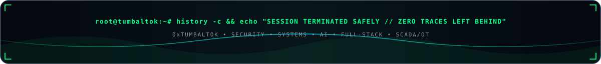
</p>
